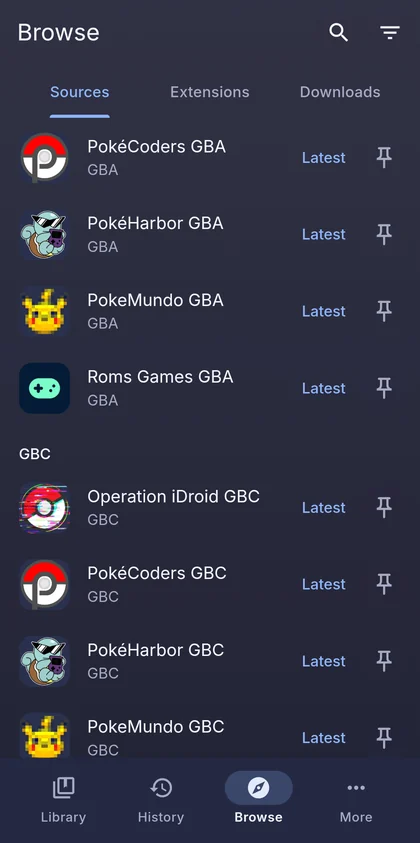
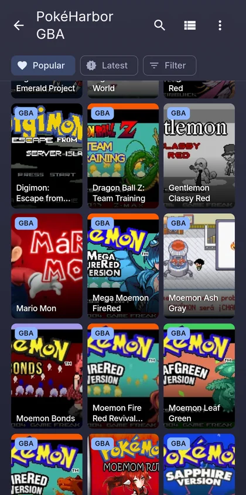
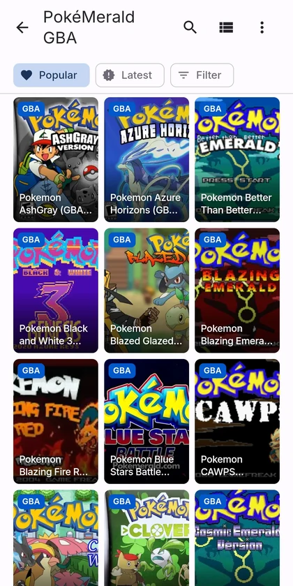
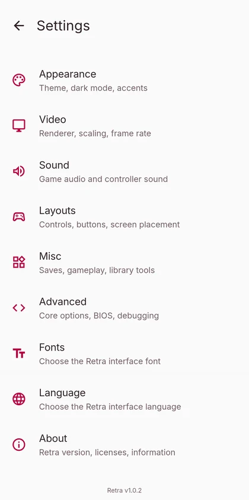

<div align="center">

<a href="https://github.com/Layfate/Retra/releases/latest">
    
</a>

# Retra

### Game Boy, Game Boy Color and Game Boy Advance on Android
Play your games with an accurate [mGBA](https://mgba.io/) core, a cover-art library, customizable controls and built-in source browsing.

[](https://github.com/Layfate/Retra/releases)
[](https://github.com/Layfate/Retra/actions/workflows/regression.yml)
[](LICENSE)

## Download

[](https://github.com/Layfate/Retra/releases/latest)

*Requires Android 8.0 or higher.*

## Screenshots






## Features

<div align="left">

* Play GB, GBC and GBA games with up to 16× fast-forward, slow motion, cheats, ROM patches and shaders.
* Smooth interface at your display's full refresh rate, up to 120 Hz.
* A library with cover art, categories, search, sorting, history and playtime statistics.
* Browse source extensions like [Mihon](https://github.com/mihonapp/mihon): search catalogs, view game details and download into your library, with a Downloads tab.
* Battery saves, save states, auto-resume, `.sav` / `.srm` import, portable `.retra` backups and optional Google Drive backup.
* Editable controls with separate portrait and landscape layouts.
* Local Link, Single-Pak / Multiboot and Remote Link over Wi-Fi or Bluetooth.
* Light, dark and translucent themes.
* Plus much more...

</div>

## Performance

<div align="left">

Retra v1.0.3 at a glance.

| | |
|---|---|
| **Game speed** | Runs at the real Game Boy Advance rate of **59.73 fps**. On 60 Hz and 120 Hz screens Retra picks the refresh mode that divides evenly into that rate, so every game frame is shown for the same time and motion doesn't stutter. |
| **Fast-forward and slow motion** | **0.2×, 0.5×, 2×, 4×, 8× and 16×**, each held at its exact speed. At 8× and 16× Retra skips drawing some frames, never game logic, and shows up to 165 frames per second on fast screens. If a phone can't keep up, it skips more drawing instead of slowing the game down. |
| **Audio** | One 32-tap resampler converts the console's sound to the phone's rate without clipping or crackle. It starts with a 32 ms buffer and an 80 ms device buffer, and only grows the buffer (up to 112 ms) after a real dropout. Changing speed clears old audio, so sound doesn't lag behind the picture. |
| **Shaders** | RetroArch `.slang` shaders are compiled on the phone and run on the GPU. |
| **Interface** | Library, Browse and settings follow the screen's refresh rate, up to 120 Hz. |
| **Cold start** | **0.74 s** to first frame* |
| **APK size** | **31.5 MB**, including native code for all four CPU types (arm64, 32-bit ARM, x86 and x86_64) |

\* Measured on a **Redmi Note 13** (Snapdragon 685, 120 Hz display, Android 15), release build, median of 5 launches, on v1.0.2.

<details>
<summary>Reproduce</summary>

```bash
adb shell am force-stop com.retra.emulator
adb shell am start -W -n com.retra.emulator/.MainActivity   # see "TotalTime"
```

</details>

</div>

## Extensions

<div align="left">

In Retra, open **Browse → Extensions → ⋮ → Extension repos → Add** and paste:

```text
https://raw.githubusercontent.com/Layfate/Retra/main/extensions/index.json
```

Install **Retra Sources**, then open **Sources**. Search games across every source with the search icon, and find what you download in the **Downloads** tab and in Library. See the [source guide](tools/extension-repo/README.md) for the included websites and how downloads work.

</div>

## Building

<div align="left">

<details>
<summary>Developer setup</summary>

Use Android Studio with JDK 17 and the project's Android SDK, NDK and CMake versions. Python 3 is needed to prepare the mGBA core.

```bash
git clone https://github.com/Layfate/Retra.git
cd Retra
python3 tools/prepare_mgba.py
```

On Windows, use `python` if `python3` is unavailable. The setup script fetches the mGBA revision pinned in [`third_party/mgba.lock`](third_party/mgba.lock). Then open the project in Android Studio, let Gradle sync, and run it on a device or emulator.

</details>

</div>

## Contributing

[Contributing guide](CONTRIBUTING.md) · [Troubleshooting](TROUBLESHOOTING.md) · [Documentation](docs/README.md) · [Changelog](CHANGELOG.md) · [Security](SECURITY.md)

Pull requests are welcome. For major changes, please open an issue first to discuss what you would like to change.

Before reporting a new issue, take a look at [Troubleshooting](TROUBLESHOOTING.md), the [changelog](CHANGELOG.md) and the already opened [issues](https://github.com/Layfate/Retra/issues).

### Credits

Retra is built on the [mGBA](https://mgba.io/) emulator core by endrift and contributors. See [Third-party notices](THIRD_PARTY_NOTICES.md).

Thank you to everyone who has contributed!

<a href="https://github.com/Layfate/Retra/graphs/contributors">
    
</a>

### Disclaimer

Retra does not include any games or BIOS files, and the developer(s) have no affiliation with Nintendo or with the content providers available through extensions. Use only games and files you are legally allowed to use.

### License

<pre>
Copyright © 2026 Zense and Retra contributors

This Source Code Form is subject to the terms of the Mozilla Public
License, v. 2.0. If a copy of the MPL was not distributed with this
file, You can obtain one at https://mozilla.org/MPL/2.0/.

The mGBA core retains its own copyright and license notices.
</pre>

</div>
