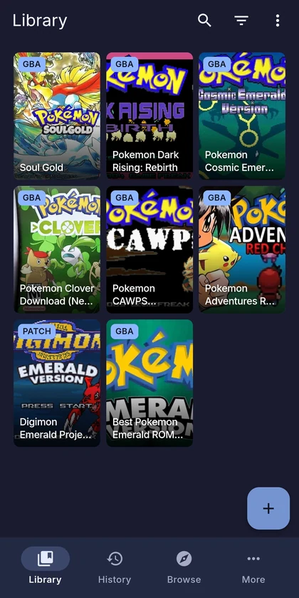
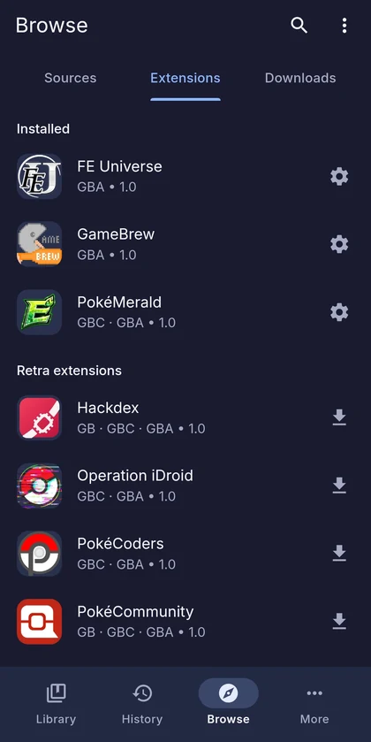
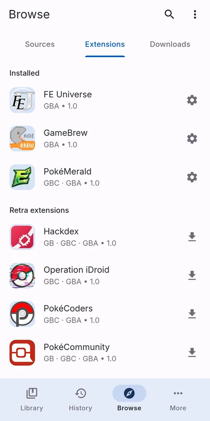

<div align="center">

<a href="https://github.com/Layfate/Retra/releases/latest">
    
</a>

# Retra

### Game Boy, Game Boy Color and Game Boy Advance on Android

Accurate emulation on the [mGBA](https://mgba.io/) core, a cover-art library, customizable controls and built-in source browsing.

<a href="https://github.com/Layfate/Retra/releases"></a>
<a href="https://github.com/Layfate/Retra/actions/workflows/regression.yml"></a>
<a href="LICENSE"></a>

## Download

<a href="https://github.com/Layfate/Retra/releases/latest"></a>

*Requires Android 8.0 or higher.*

## Screenshots






</div>

## Features

- **Emulation:** GB, GBC and GBA games with fast-forward up to 16×, slow motion, cheats, ROM patches and RetroArch shaders.
- **Library:** cover art, categories, search, sorting, history and playtime statistics.
- **Browse:** source extensions in the style of [Mihon](https://github.com/mihonapp/mihon). Search catalogs, view game details and download straight into your library.
- **Saves:** battery saves, save states, auto-resume, `.sav` / `.srm` import, portable `.retra` backups and optional Google Drive backup.
- **Controls:** a fully editable on-screen controller with separate portrait and landscape layouts.
- **Multiplayer:** Local Link, Single-Pak / Multiboot, and Remote Link over Wi-Fi or Bluetooth.
- **Design:** a responsive Material interface with light, dark and translucent themes.

## Performance

| | |
|---|---|
| **Accurate timing** | Games run at the console's native 59.73 fps, with even frame pacing on every display. |
| **Exact speeds** | 0.2×, 0.5×, 2×, 4×, 8× and 16× are each held precisely. At high speeds Retra skips drawing frames, never game logic. |
| **Clean audio** | A band-limited resampler with an adaptive buffer prevents crackle, and audio stays in sync when the speed changes. |
| **GPU shaders** | RetroArch `.slang` and `.glsl` shaders are compiled on the device and run on the GPU. |
| **Fast start** | 0.74 s from launch to first frame.\* |
| **Small install** | 31.5 MB, including native code for arm64, ARMv7, x86 and x86_64. |

<sub>\* Redmi Note 13 (Snapdragon 685, Android 15), release build, median of five cold launches.</sub>

## Extensions

In Retra, open **Browse → Extensions → ⋮ → Extension repos → Add** and paste:

```text
https://raw.githubusercontent.com/Layfate/Retra/main/extensions/index.json
```

Each website (Operation iDroid, PokéHarbor, Roms Games, …) is its own extension. Install the ones you want, then open **Sources**. Downloads appear in the **Downloads** tab and in your Library. The [source guide](tools/extension-repo/README.md) lists the included websites and explains how downloads work.

## Building

Requires Android Studio, JDK 17 and Python 3.

```bash
git clone https://github.com/Layfate/Retra.git
cd Retra
python3 tools/prepare_mgba.py   # fetches the mGBA revision pinned in third_party/mgba.lock
```

Open the project in Android Studio, let Gradle sync, and run it on a device or emulator. On Windows, use `python` if `python3` is unavailable. See the [developer docs](docs/README.md) for architecture, testing and release details.

## Contributing

[Contributing guide](CONTRIBUTING.md) · [Developer docs](docs/README.md) · [Troubleshooting](TROUBLESHOOTING.md) · [Changelog](CHANGELOG.md) · [Security](SECURITY.md)

Pull requests are welcome. For larger changes, please open an issue first. Before reporting a problem, check [Troubleshooting](TROUBLESHOOTING.md) and the existing [issues](https://github.com/Layfate/Retra/issues).

<p align="center">
  <a href="https://github.com/Layfate/Retra/graphs/contributors">
    
  </a>
</p>

## Credits

Retra is built on the [mGBA](https://mgba.io/) emulator core by endrift and contributors. See [Third-party notices](THIRD_PARTY_NOTICES.md).

## Disclaimer

Retra does not include any games or BIOS files and is not affiliated with Nintendo or with the content providers available through extensions. Use only games and files you are legally allowed to use.

## License

```text
Copyright © 2026 Zense and Retra contributors

This Source Code Form is subject to the terms of the Mozilla Public
License, v. 2.0. If a copy of the MPL was not distributed with this
file, You can obtain one at https://mozilla.org/MPL/2.0/.

The mGBA core retains its own copyright and license notices.
```
